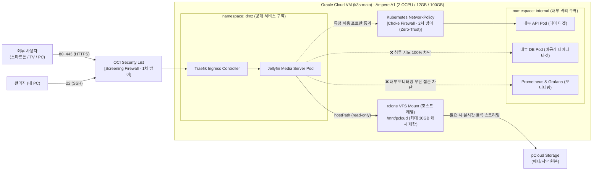

# Cloud Media Server & Zero-Trust Defense Network (B안 아키텍처 명세)

## 1. 프로젝트 소개
Oracle Cloud Infrastructure(OCI) Always Free 자원(Ampere A1 ARM 2 OCPU / 12GB)을 100% 활용하여 구축한 **k3s(쿠버네티스) 기반 애니 미디어 스트리밍 서버**이자, **이중 방화벽(Screening + Choke) 보안 아키텍처**를 적용한 데브옵스/시큐리티 실습 프로젝트입니다.

---

## 2. 아키텍처 다이어그램 (Mermaid)

---

## 3. 인프라 및 서버 스펙 명세

| 구분 | 사양 / 설정값 | 비고 |
| :--- | :--- | :--- |
| **클라우드 벤더** | Oracle Cloud Infrastructure (OCI) | Always Free 평생 무료 티어 |
| **리전 (Region)** | US West (San Jose) | 홈 리전 |
| **인스턴스명** | `k3s-main` | 단일 노드 올인원 클러스터 |
| **컴퓨트 셰이프** | `VM.Standard.A1.Flex` (서버용 Neoverse N1 ARM64) | x86 대비 고성능/저전력 |
| **CPU / RAM** | **2 OCPU (물리 2코어) / 12GB RAM** | Always Free 한도 100% 최적화 |
| **네트워크 대역폭** | **2 Gbps** | 실시간 영상 스트리밍 병목 0 |
| **스토리지 (디스크)** | 부트 볼륨 **100 GB** | rclone 캐시 최대 30GB 할당 |
| **공인 IP (Public IP)** | `147.224.xx.xx` (Ephemeral IPv4) | GitHub 공개 보안 마스킹 |
| **사설 IP (Private IP)** | `10.0.0.5` | VCN 내부 사설 대역 |
| **운영체제** | Canonical Ubuntu 24.04 Minimal aarch64 | 경량화 보안 OS |
