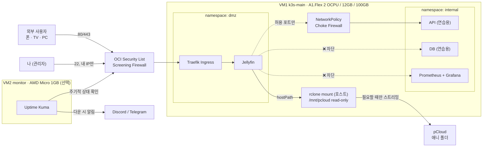

# Oracle Cloud k3s 애니 미디어 서버 로드맵 (B안)

VM 1대에 k3s 단일 노드를 올리고 **네임스페이스(`dmz` / `internal`)**로 구역을 분리하여, pCloud 애니메이션 스트리밍과 이중 방화벽(Screening + Choke) 실습을 함께 진행하는 최종 계획입니다.

---

## 1. 목표

| 우선순위 | 목표 |
| :---: | :--- |
| 1 | pCloud에 있는 애니메이션을 어디서든 Jellyfin으로 스트리밍 시청 |
| 2 | 이중 방화벽(Screening + Choke) 개념을 Kubernetes로 구현하고 `nmap`으로 검증 |
| 3 | Prometheus + Grafana로 리소스 및 캐시 모니터링 (외부 노출 차단) |
| 4 | **Oracle Always Free 한도 내**에서 추가 요금 0원으로 운영 |

---

## 2. 전체 구조

### 이중 방화벽 매핑

| 실습 랩 개념 | 이 프로젝트에서 |
| :--- | :--- |
| InternetRouter | Oracle 인터넷 게이트웨이 |
| **Screening Firewall** | **OCI Security List** (+ VM 안의 `iptables`) |
| Screened Subnet (DMZ) | `dmz` 네임스페이스 (`Traefik`, `Jellyfin`) |
| **Choke Firewall** | **NetworkPolicy** (`default-deny`) |
| 내부망 (LAN) | `internal` 네임스페이스 (`API`, `DB`, `Grafana`) |

---

## 3. 자원 계획 및 메모리 예산

### Always Free 한도 대비

| 자원 | 한도 | 사용 계획 | 남음 |
| :--- | :--- | :--- | :--- |
| A1 OCPU / 메모리 | 2 OCPU / 12 GB | `k3s-main` 2 OCPU / 12 GB | 0 |
| AMD Micro | 2대 | (선택) `monitor` 1대 | 1~2대 |
| 블록 스토리지 | 200 GB | `k3s-main` 100 GB (+ 선택 Micro 50 GB) | 50~100 GB |
| 아웃바운드 트래픽 | 월 10 TB | 애니 시청 수준이면 여유 | 9 TB 이상 |

### VM1 메모리 예산 (12 GB 기준)

| 구성요소 | 예상 메모리 | 제한(limit) 설정 |
| :--- | :--- | :--- |
| OS + k3s + Traefik | 약 1.2 GB | - |
| Jellyfin | 1 ~ 3 GB | `4Gi` |
| rclone (호스트) | 약 0.5 GB | 캐시 상한 `30G` 디스크 제한 |
| Prometheus + Grafana | 약 1.5 ~ 2 GB | Prometheus `1Gi`, Grafana `256Mi` |
| API + DB (더미 타겟) | 약 0.2 ~ 1 GB | 각 `512Mi` |
| **합계** | **약 5 ~ 8 GB / 12 GB** | 여유 4 GB 이상 |

---

## 4. 진행 단계 체크리스트

### Phase 0: 준비 (완료)
- [x] Oracle Cloud 가입 (홈 리전: US West San Jose)
- [x] Shape `VM.Standard.A1.Flex`, 이미지 `Ubuntu 24.04 Minimal aarch64` 선택

### Phase 1: VM1 생성 및 스케일업 (완료)
- [x] `Out of host capacity` 극복 (브라우저 자동 생성 매크로 + 1 OCPU 선확보)
- [x] VCN(`k3s-vcn`) / 퍼블릭 서브넷(`k3s-subnet`) 및 Public IPv4(`147.224.xx.xx`) 할당
- [x] SSH 키 저장 및 PowerShell에서 SSH 접속 확인
- [x] 2 OCPU / 12 GB RAM / 100 GB 부트 볼륨 구성 완료

### Phase 2: OS 기본 설정 (완료)
- [x] `sudo apt update && sudo apt install -y curl wget vim nano htop iotop net-tools`
- [x] `sudo apt upgrade -y` 및 시간대 확인 (`Etc/UTC`, 별도 변경 없이 유지)
- [x] OCI Ubuntu 이미지의 `iptables`에서 80/443 및 K3s CIDR(`10.42.0.0/16`, `10.43.0.0/16`) 허용, `FORWARD` 기본 차단 해제 및 `netfilter-persistent save`
- [x] 자동 보안 업데이트(`unattended-upgrades` active) 및 SSH 비밀번호 로그인 비활성화(`PasswordAuthentication no`, `KbdInteractiveAuthentication no`) 확인

### Phase 3: Screening Firewall (OCI Security List)
| 포트 | 출발지 | 용도 |
| :--- | :--- | :--- |
| 22/TCP | **내 집 IP/32** (권장) | SSH |
| 80/TCP | `0.0.0.0/0` | Let's Encrypt 인증 및 HTTPS 리다이렉트 |
| 443/TCP | `0.0.0.0/0` | Jellyfin (HTTPS) |
| 그 외 | 차단 | `6443`(kube API)은 SSH 터널로만 접근 |

- [ ] Security List 수신 규칙 추가
- [ ] 외부에서 `nmap`으로 확인 → 22(내 IP), 80, 443만 열려 있는지 검증

### Phase 4: k3s 설치
- [ ] k3s 단일 노드 설치
- [ ] `kubeconfig`를 내 PC로 복사 후 SSH 터널(`-L 6443:localhost:6443`)로 `kubectl` 연결
- [ ] Helm 설치
- [ ] 네임스페이스 `dmz`, `internal` 생성

### Phase 5: pCloud 연동 (호스트)
- [ ] `rclone` 설치 후 `rclone config`로 pCloud 연결
- [ ] `systemd` 서비스로 `/mnt/pcloud` 자동 마운트 (`--read-only --vfs-cache-mode full --vfs-cache-max-size 30G --vfs-cache-max-age 24h --allow-other`)
- [ ] 재부팅 후 자동 마운트 확인

### Phase 6: Jellyfin 배포 (`dmz`)
- [ ] Deployment 작성 (`hostPath` readOnly + `mountPropagation: HostToContainer`, non-root, `allowPrivilegeEscalation: false`, `automountServiceAccountToken: false`)
- [ ] 라이브러리 설정: 실시간 폴더 감시, 챕터 이미지, Trickplay 비활성화
- [ ] 클라이언트(Jellyfin Media Player, Findroid 등)에서 Direct Play 확인 (ASS 자막 포함)

### Phase 7: 외부 공개
- [ ] 도메인 연결 (DuckDNS 등 무료 DDNS 또는 개인 도메인)
- [ ] `cert-manager` + Let's Encrypt로 HTTPS 적용 및 Traefik Ingress 설정
- [ ] 외부 망(LTE)에서 접속 테스트 및 CrowdSec/fail2ban 적용

### Phase 8: 내부 서비스 및 모니터링 (`internal`)
- [ ] 더미 API, DB Pod 배포 (Choke 방화벽 검증 타겟)
- [ ] `kube-prometheus-stack` 배포 (보존 기간 7일, 메모리 limit 설정)
- [ ] Grafana는 `kubectl port-forward`로만 접근

### Phase 9: Choke Firewall (`NetworkPolicy`)
- [ ] `dmz`, `internal`에 `default-deny` (Ingress 및 Egress) 적용
- [ ] 공통 허용: CoreDNS 53 포트
- [ ] `dmz`: Traefik → Jellyfin 8096 허용, Jellyfin → 인터넷(메타데이터, `169.254.169.254` 및 클러스터 내부 대역 제외), Jellyfin → `internal` API 특정 포트만 허용
- [ ] `internal`: Prometheus scrape 허용, 그 외 외부 및 DMZ 유입 차단

### Phase 10: 침투 검증
Jellyfin Pod가 탈취되었다고 가정하고 `dmz` 네임스페이스 디버그 Pod 내부에서 `nmap` 스캔 실행:

| 대상 | 기대 결과 |
| :--- | :--- |
| API 허용 포트 | ✅ 열림 |
| DB | ❌ 차단 |
| Grafana / Prometheus | ❌ 차단 |
| `169.254.169.254` (OCI 메타데이터) | ❌ 차단 |
| kube API (`6443` / `kubernetes.default`) | ❌ 토큰 부재로 거부 |

- [ ] 검증 결과 및 스크린샷을 포트폴리오에 기록

### Phase 11 (선택): 외부 감시용 VM2
- [ ] AMD Micro 인스턴스 생성 (부트 볼륨 50 GB)
- [ ] Docker로 Uptime Kuma 설치 및 다운 시 Discord/Telegram 알림 연결
