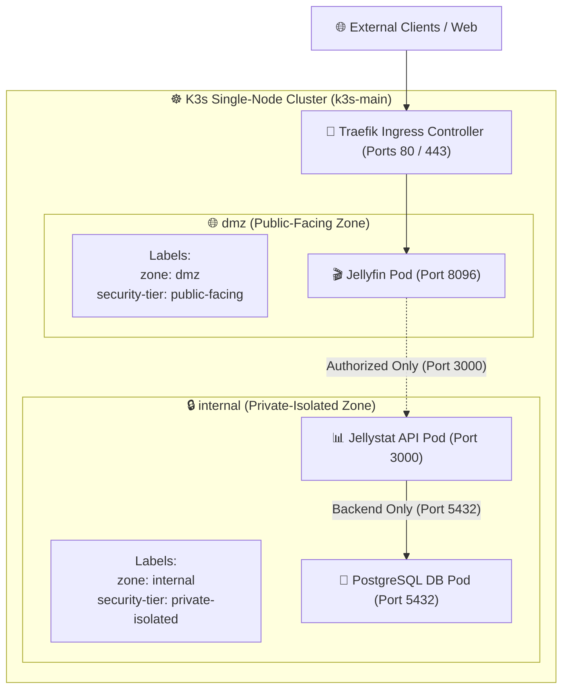
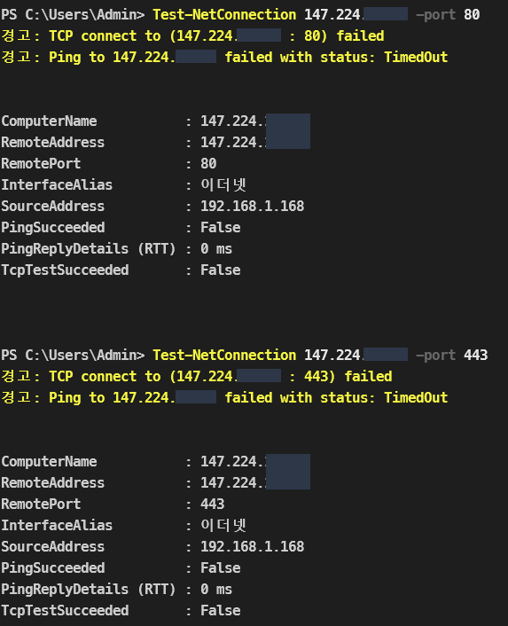
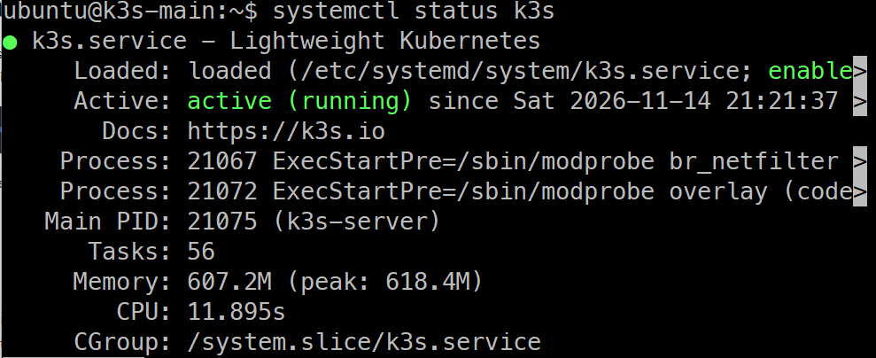
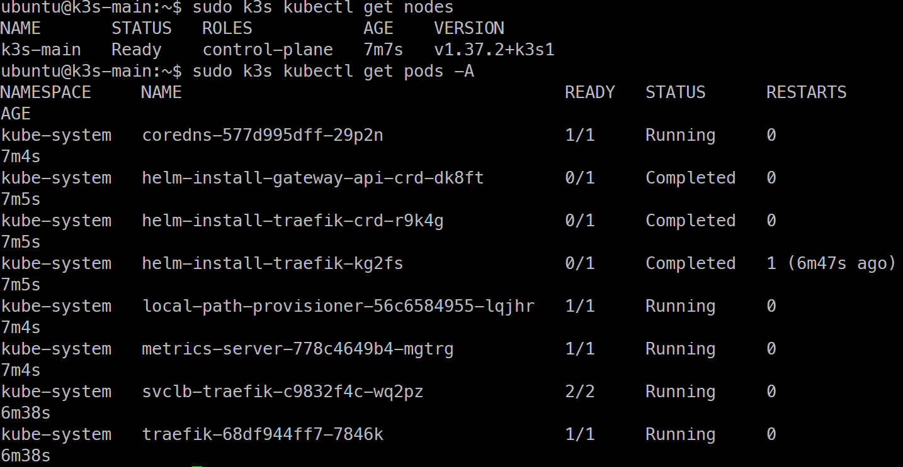
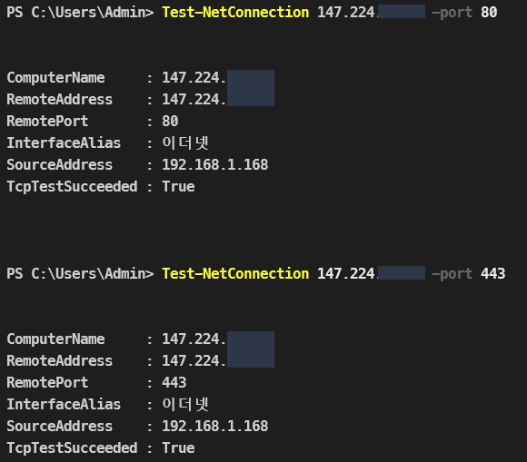
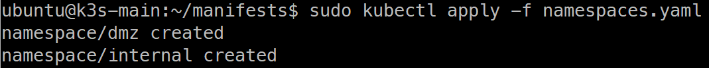
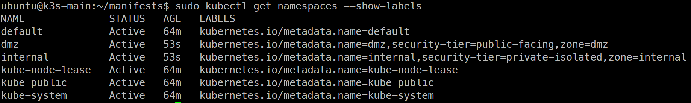

# 03. Lightweight Kubernetes (K3s) Cluster & Network Isolation

## 📌 개요 (Overview)
본 문서는 OCI Always Free ARM64 인스턴스(`k3s-main`, 2 OCPU / 12GB RAM)에 경량 쿠버네티스인 **K3s (v1.37.2+k3s1)** 클러스터를 구축하고, 이중 방화벽 아키텍처에 기반한 보안 네임스페이스(`dmz`, `internal`)를 구성한 과정을 다룹니다.

---

## 🏗️ 네임스페이스 및 보안 티어 아키텍처



---

## 📄 IaC 매니페스트 명세

### 1. 보안 네임스페이스 선언 (`manifests/01_namespaces.yaml`)
```yaml
apiVersion: v1
kind: Namespace
metadata:
  name: dmz
  labels:
    zone: dmz
    security-tier: public-facing
---
apiVersion: v1
kind: Namespace
metadata:
  name: internal
  labels:
    zone: internal
    security-tier: private-isolated
```

---

## 📸 검증 증적 (Verification Evidence)

### 1. K3s 설치 전 포트 접근 차단 검증 (`TcpTestSucceeded: False`)


### 2. K3s 데몬 실행 상태 (`active running`)


### 3. 노드 및 기본 시스템 파드 구동 상태


### 4. K3s 설치 후 Traefik 인그레스 80/443 포트 리스닝 검증 (`TcpTestSucceeded: True`)


### 5. 선언형 매니페스트 적용 및 보안 레이블 검증


