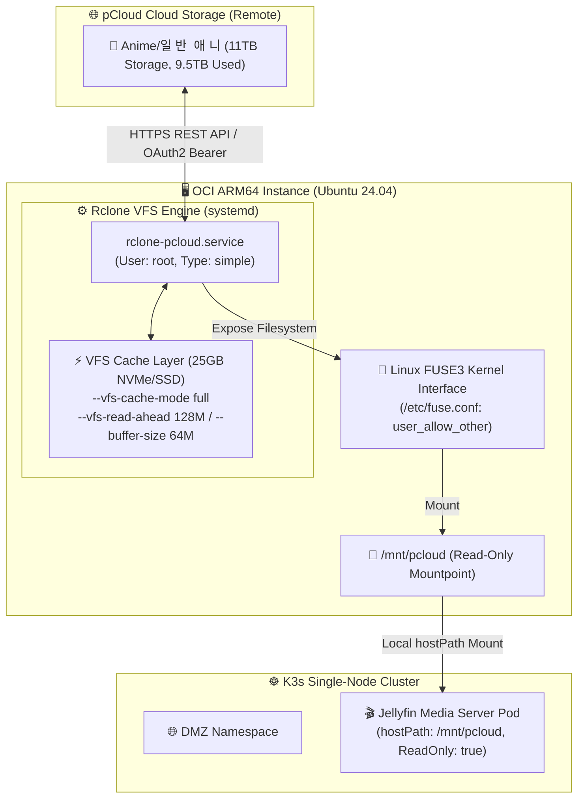
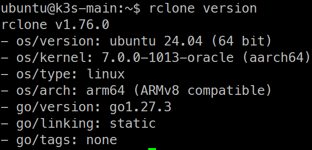
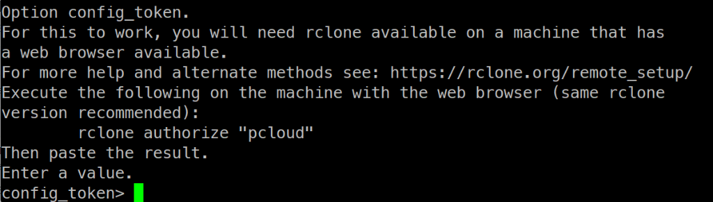
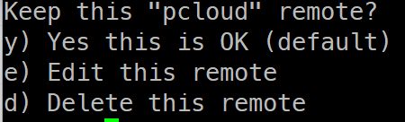
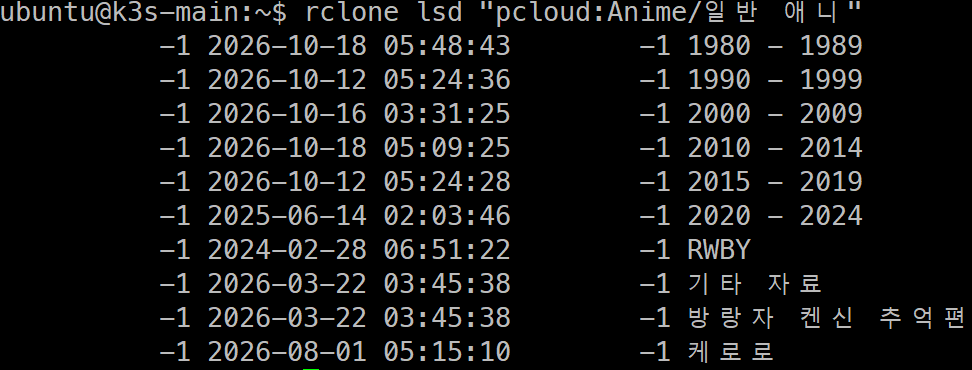
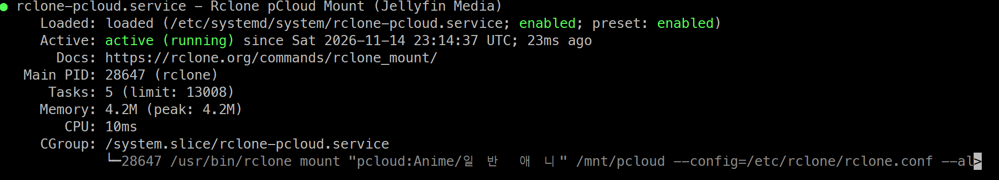
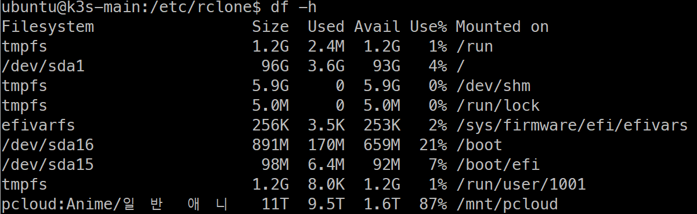

# 04. Cloud Storage Layer (pCloud & Rclone VFS)

## 📌 개요 (Overview)
본 문서는 OCI VM(`k3s-main`, ARM64) 환경에서 11TB 규모의 대용량 클라우드 스토리지(**pCloud**)를 고속 스트리밍 미디어 디스크로 변환하여 리눅스 로컬 파일시스템(`/mnt/pcloud`)에 안전하게 마운트하는 **Rclone VFS (Virtual File System) 아키텍처**를 다룹니다.

미디어 스트리밍 서버(Jellyfin)의 대용량 트래픽과 탐색(Seeking) 부하를 처리하면서도, 원본 클라우드 데이터의 무결성과 보안을 보장하기 위해 **최소 권한(Least Privilege) 읽기 전용(`--read-only`) 격리 원칙**을 적용했습니다.

---

## 🏗️ 스토리지 아키텍처 및 데이터 흐름



---

## 🛡️ 엔지니어링 및 보안 설계 원칙

### 1. 최소 권한(Least Privilege) & 무결성 보장 (`--read-only`)
- **읽기 전용 마운트**: Jellyfin Pod 또는 외부 침입자가 파일 시스템에 악의적인 쓰기/삭제를 시도하더라도, 원본 클라우드 데이터가 손상되지 않도록 파일시스템 레벨에서 `--read-only`를 강제합니다.
- **특정 디렉터리 격리**: pCloud 루트 전체가 아닌, 미디어 전용 하위 디렉터리(`Anime/일 반  애 니`)만을 타겟팅하여 개인 문서/백업 데이터로의 접근 경로를 원천 차단했습니다.

### 2. 고성능 미디어 스트리밍 VFS 캐시 튜닝
대용량 고화질 영상(1080p FHD/4K)의 실시간 탐색(Seek) 및 다중 버퍼링 지연을 최소화하기 위해 아래 파라미터로 최적화했습니다:
- **`--vfs-cache-mode full`**: 비순차적 파일 접근(Seek/Range Request)을 로컬 블록 장치 수준으로 캐싱하여 끊김 없는 재생 보장.
- **`--vfs-cache-max-size 25G`**: 100GB 부트 볼륨 중 25GB를 캐시 상한선으로 지정하여 약 25~50화 분량의 영상을 SSD 속도로 서빙하고 디스크 풀(Disk Full) 방지.
- **`--vfs-cache-max-age 24h`**: 24시간 동안 미사용된 캐시 청크를 자동 회수(LRU).
- **`--vfs-read-ahead 128M` & `--buffer-size 64M`**: 재생 시작 및 탐색 시 초기 지연 시간(TTFB) 단축.
- **`--dir-cache-time 72h` & `--poll-interval 1m`**: 디렉터리 메타데이터를 72시간 동안 메모리에 유지하여 pCloud API 호출량 절감.

### 3. FUSE3 및 보안 자격 증명 보호
- **`chmod 600 /etc/rclone/rclone.conf`**: pCloud OAuth2 Refresh Token이 저장된 설정 파일에 대해 root 관리자 외 모든 사용자의 읽기 권한을 박탈.
- **`/etc/fuse.conf` (`user_allow_other`)**: K3s 컨테이너 내부의 비루트(Non-root) 프로세스에서도 마운트된 볼륨을 정상적으로 참조할 수 있도록 설정.

---

## 📄 시스템 서비스 명세서 (`rclone-pcloud.service`)

`/etc/systemd/system/rclone-pcloud.service`:

```ini
[Unit]
Description=Rclone pCloud Mount (Jellyfin Media)
Documentation=https://rclone.org/commands/rclone_mount/
After=network-online.target
Wants=network-online.target

[Service]
Type=simple
User=root
ExecStart=/usr/bin/rclone mount "pcloud:Anime/일 반  애 니" /mnt/pcloud \
    --config=/etc/rclone/rclone.conf \
    --allow-other \
    --read-only \
    --vfs-cache-mode full \
    --vfs-cache-max-size 25G \
    --vfs-cache-max-age 24h \
    --vfs-read-ahead 128M \
    --buffer-size 64M \
    --dir-cache-time 72h \
    --poll-interval 1m \
    --umask 022 \
    --log-level INFO \
    --log-file /var/log/rclone.log
ExecStop=/bin/fusermount3 -u -z /mnt/pcloud
Restart=on-failure
RestartSec=10

[Install]
WantedBy=multi-user.target
```

---

## 📸 검증 증적 (Verification Evidence)

### 1. Rclone v1.76.0 ARM64 설치 확인


### 2. 헤드리스 환경 OAuth2 원격 인증 토큰 발급



### 3. pCloud 타겟 폴더 디렉터리 목록 조회 검증 (`rclone lsd`)


### 4. systemd 서비스 활성화 및 데몬 상태 (`active running`)


### 5. 파일시스템 마운트 용량 확인 (`df -h`)
총 11TB 규모의 pCloud 저장소가 로컬 `/mnt/pcloud` 경로에 87% 사용량(9.5TB 사용 / 1.6TB 가용)으로 정상 마운트되었습니다.

