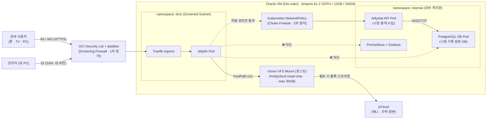
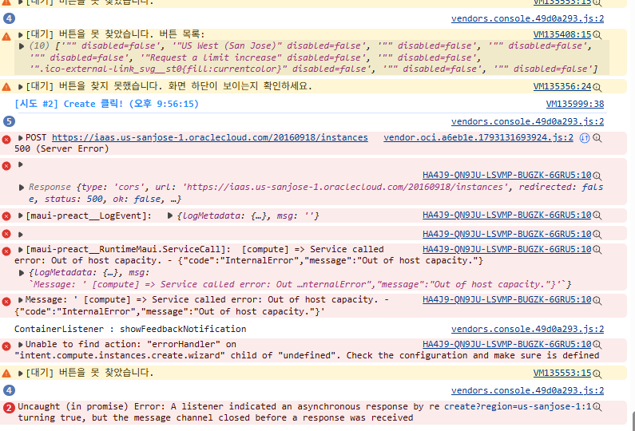
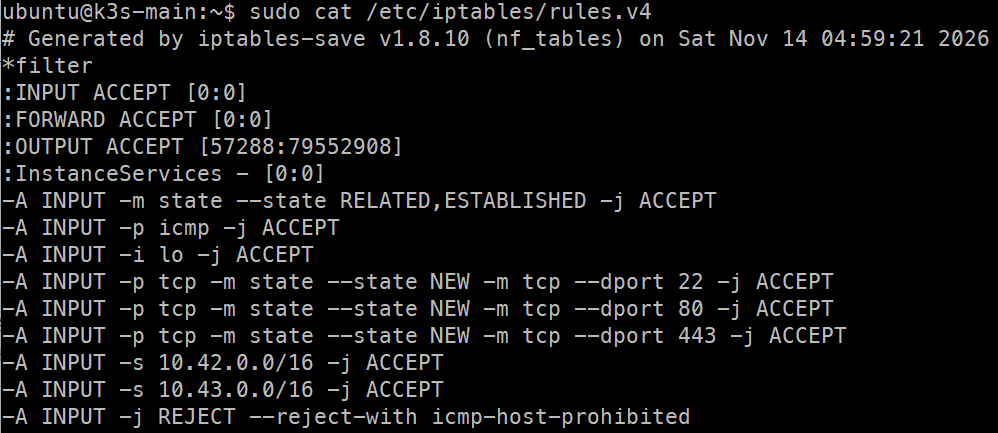
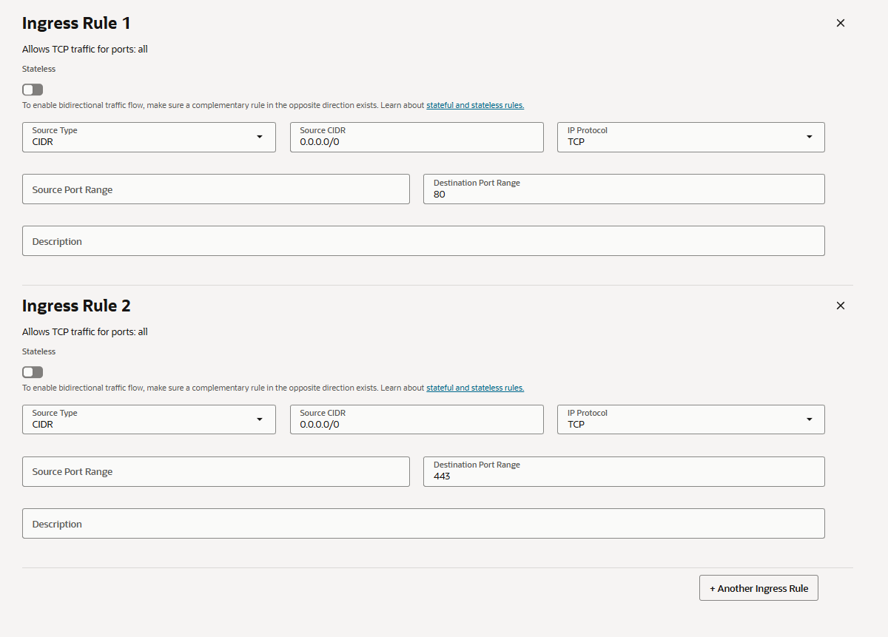
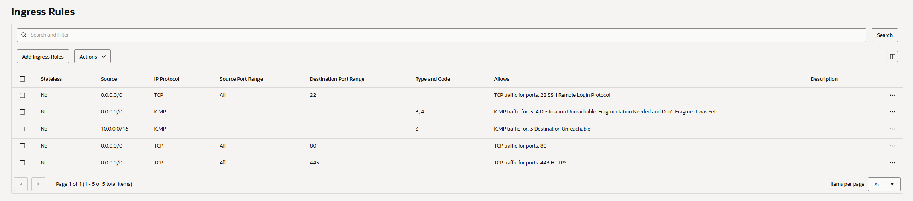
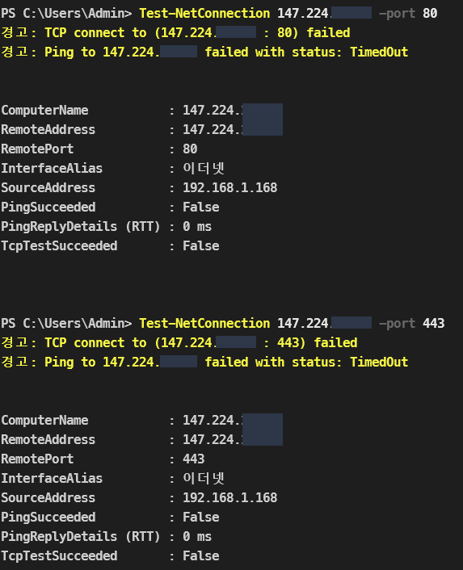
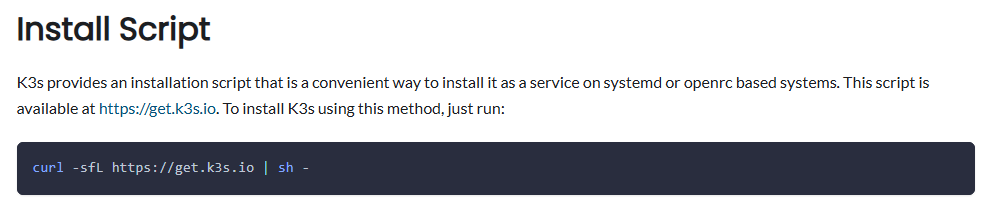
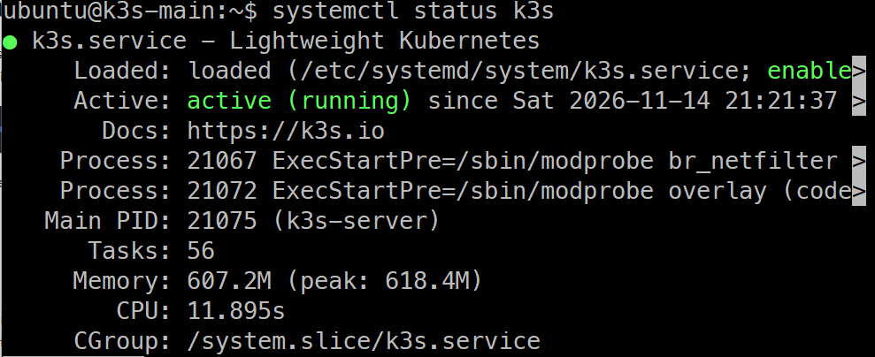
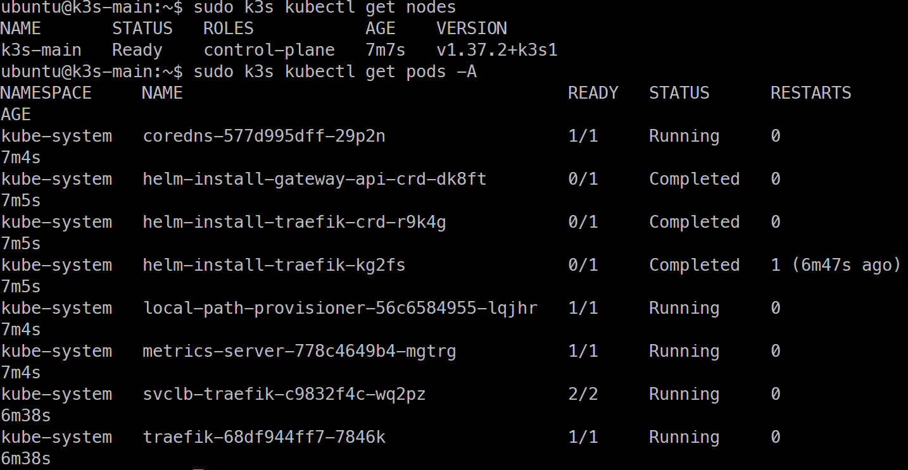
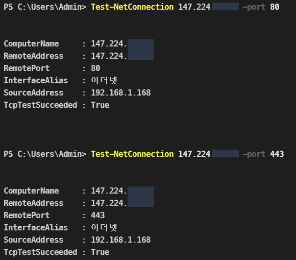

# 포트폴리오 상세 작업 기록집: Cloud Media Server & Zero-Trust Defense Network

> **프로젝트 요약**: Oracle Cloud Always Free ARM(Ampere A1) 인스턴스 위에 구축한 k3s(쿠버네티스) 기반 미디어 스트리밍 서버 및 이중 방화벽(Screening + Choke) 보안 검증 기록집입니다.  
> ※ 전체 요약 및 목차는 [README.md](./README.md)에서 확인할 수 있습니다.

---

## 0. 아키텍처 개요 (이중 방화벽 구조)



---

## 1. 인프라 프로비저닝 및 트러블슈팅 (OCI Always Free ARM)

### 1.1 문제 상황: 인기 리전 ARM 용량 부족 (`Out of host capacity`)
* **환경**: Oracle Cloud Infrastructure (OCI), US West (`us-sanjose-1`) 홈 리전
* **발생 오류**: `VM.Standard.A1.Flex` 인스턴스 생성 시 `500-InternalError, Out of host capacity` 에러가 반복 발생해 생성이 거부됨.

### 1.2 해결 과정: 자동 요청 매크로 제작 + 선확보 후 스케일업
1. **브라우저 DOM 자동화 스크립트 구현**: 오라클 콘솔의 생성 버튼(`button[aria-label="Create"]`)을 타겟팅하여 30초 간격으로 생성 요청을 재시도하는 [`oci_auto_creator_macro.js`](./02_infrastructure_oci/oci_auto_creator_macro.js) 작성.
2. **단계적 리소스 확보 전략**: 2 OCPU 연속 유휴 슬롯 대신 **1 OCPU / 6GB** 단위로 먼저 인스턴스를 확보한 뒤, PAYG 계정 업그레이드 및 리소스 조정을 통해 **2 OCPU / 12GB RAM**으로 안전하게 스케일업 완료.
3. **종료 안전장치**: 인스턴스 생성 성공 시 상세 페이지 URL(`/instances/ocid1.`) 전환을 감지해 타이머를 자동 종료.

#### 증빙 1: 자동 생성 매크로 실행 및 API 요청 로그


---

### 1.3 공인 IP 동적 바인딩 및 2 OCPU / 12GB 스케일업 검증

* **인스턴스명**: `k3s-main`
* **OS**: Canonical Ubuntu 24.04 Minimal `aarch64`
* **사양**: Ampere A1 (`2 OCPU / 12 GB RAM / 2 Gbps` 네트워크 대역폭)
* **스토리지**: 부트 볼륨 `100 GB` (총 200 GB 무료 한도 내)
* **네트워크**: VCN `k3s-vcn` / Subnet `k3s-subnet` / Private IP `10.0.0.5` / Public IP `147.224.xx.xx` (Ephemeral)

#### 증빙 2: Primary VNIC 공인 IP(Public IP) 동적 할당


#### 증빙 3: 2 OCPU / 12GB RAM 스케일업 및 `Running` 상태 검증


---

## 2. 서버 베이스라인 환경 구성 및 필수 도구 설치

* **OS 선정 이유**: 불필요한 백그라운드 데몬과 패키지를 제거해 공격 표면(Attack Surface)을 줄이고 가용 메모리를 극대화하기 위해 **Ubuntu 24.04 Minimal (`aarch64`)** 선택.
* **초기 설치 유틸리티 7종**:

```bash
sudo apt update && sudo apt install -y curl wget vim nano htop iotop net-tools
```

| 패키지 | 용도 및 선정 이유 |
| :--- | :--- |
| `curl`, `wget` | `k3s`, `rclone` 등 설치 스크립트 다운로드 및 API 응답 확인 |
| `vim`, `nano` | Kubernetes YAML 매니페스트 및 `systemd` 서비스 파일 편집 |
| `htop` | ARM64 CPU 코어별 부하 및 메모리 점유율 실시간 모니터링 |
| `iotop` | `rclone` VFS 캐시 쓰기/읽기 시 디스크 I/O 병목 분석 |
| `net-tools` | `netstat`, `ifconfig`, `route` 등 네트워크 포트 리스닝 상태 진단 |

### 2.2 OCI Ubuntu 내부 방화벽(`iptables`) 설정 이유 및 적용 내역

* **배경 (정문 vs 현관문)**: 일반 클라우드(AWS 등)의 우분투는 현관문(`iptables`)이 기본적으로 열려 있어 클라우드 콘솔(정문)만 열면 되지만, **오라클 클라우드(OCI) 우분투 이미지는 출고 시점부터 현관문(`iptables`)이 `22번(SSH)`만 남기고 전부 강제 잠금(`REJECT --reject-with icmp-host-prohibited`)** 상태로 제공됩니다.
* **적용 내역 (`/etc/iptables/rules.v4`, 원본 `/etc/iptables/rules.v4.bak` 백업 후 `netfilter-persistent save`)**:
  1. **`80`, `443` 포트 허용 (`INPUT` 5·6번)**: Jellyfin 웹/앱 접속(HTTPS `443`) 및 인증서 발급·리다이렉트(HTTP `80`)를 위해 추가. `iptables`는 상단 번호부터 순서대로 평가하므로 마지막 `9번 REJECT`보다 **위쪽 번호**에 배치해 통과시키고, 나머지 미허용 포트는 기존처럼 `REJECT`로 방어.
  2. **K3s Pod/Service 대역 허용 (`INPUT` 7·8번 — `10.42.0.0/16`, `10.43.0.0/16`)**: 파드(Jellyfin, Traefik, CoreDNS)와 쿠버네티스 내부 서비스가 호스트와 통신할 때 `REJECT`에 의해 외부 침입으로 오인·차단되는 것을 방지.
  3. **`FORWARD` 체인 기본 `REJECT` 제거**: 파드 간 및 외부(`pCloud`) 트래픽 전달 통로의 기본 차단을 해제해 K3s CNI와 이후 2차 방화벽(`NetworkPolicy`)이 정상 동작하도록 조치.
* **검증 명령어**:
  ```bash
  sudo iptables -L INPUT -n -v --line-numbers
  sudo iptables -L FORWARD -n -v --line-numbers
  sudo diff -u /etc/iptables/rules.v4.bak /etc/iptables/rules.v4
  ```



### 2.3 Screening Firewall (OCI Security List) 구성 및 K3s 설치 전 포트 검증

* **Ingress Rules 개방 (`80/TCP`, `443/TCP`)**:
  * 클라이언트(폰·PC)가 먼저 접속을 시작하는 구조이므로 Stateful 방화벽인 OCI Security List의 **`Ingress Rules`**에 `0.0.0.0/0` → Destination `80`, `443`을 추가 (`Source Port Range`는 임의 포트 허용을 위해 빈칸/`All`).
  * 기본 `ICMP` 규칙은 Type `3, 4`만 허용되어 `ping` (Type `8`) 응답은 차단 상태 유지.
* **K3s 설치 전 방화벽 통과 검증**:
  * 외부 `curl` 테스트로 VM 내 `iptables -L INPUT -n -v`의 80·443 `pkts` 카운터 증가(`0 → 5`, `0 → 3`)를 확인해 OCI Security List 통과를 검증했고, 아직 리스닝 데몬(Traefik)이 없어 `Test-NetConnection` 기준선(`TcpTestSucceeded : False`)을 기록해 두었습니다.







### 2.4 K3s 단일 노드 클러스터 구축 및 포트 활성화 검증

* **공식 스크립트 기반 설치**:
  ```bash
  curl -sfL https://get.k3s.io | sh -
  sudo chmod 644 /etc/rancher/k3s/k3s.yaml
  ```
* **서비스 가동 및 노드 준비 확인**:
  * `systemctl status k3s` 명령으로 `k3s.service`가 `active (running)` 상태임을 확인.
  * `kubectl get nodes -o wide` 실행 결과, `k3s-main` 노드가 `Ready` 상태(`v1.37.2+k3s1`)로 정상 등록됨.
  * `kubectl get pods -A` 실행 결과, `CoreDNS`, `metrics-server`, `local-path-provisioner` 및 웹 트래픽 라우팅을 담당하는 `svclb-traefik (2/2)`, `traefik (1/1)`이 정상 `Running` 상태로 올라옴.







* **외부 포트 활성화 Before / After 비교**:
  * K3s 설치 전 `Test-NetConnection` 결과가 리스너 부재로 `False`였던 상태에서, `Traefik` 구동 후 `80`번(HTTP) 및 `443`번(HTTPS) 모두 `TcpTestSucceeded : True`로 전환됨을 확인.



---

## 3. 향후 기록 예정 항목
* **네임스페이스 격리**: `dmz` / `internal` 네임스페이스 분리 및 `kubectl` 조회 캡처
* **스토리지 가상화**: `rclone` pCloud VFS 캐시 마운트(`--vfs-cache-max-size 30G`) 및 Jellyfin Direct Play 검증
* **Choke Firewall & 침투 테스트**: `NetworkPolicy` 적용 후 DMZ Pod 내부에서 `nmap` 스캔을 통한 DB/모니터링 차단 증빙
