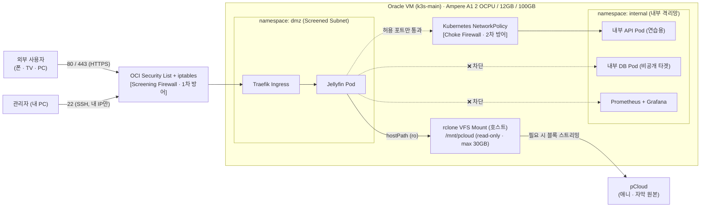
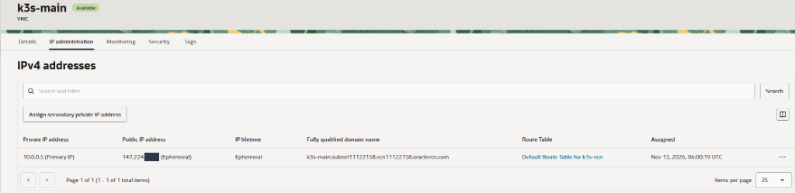
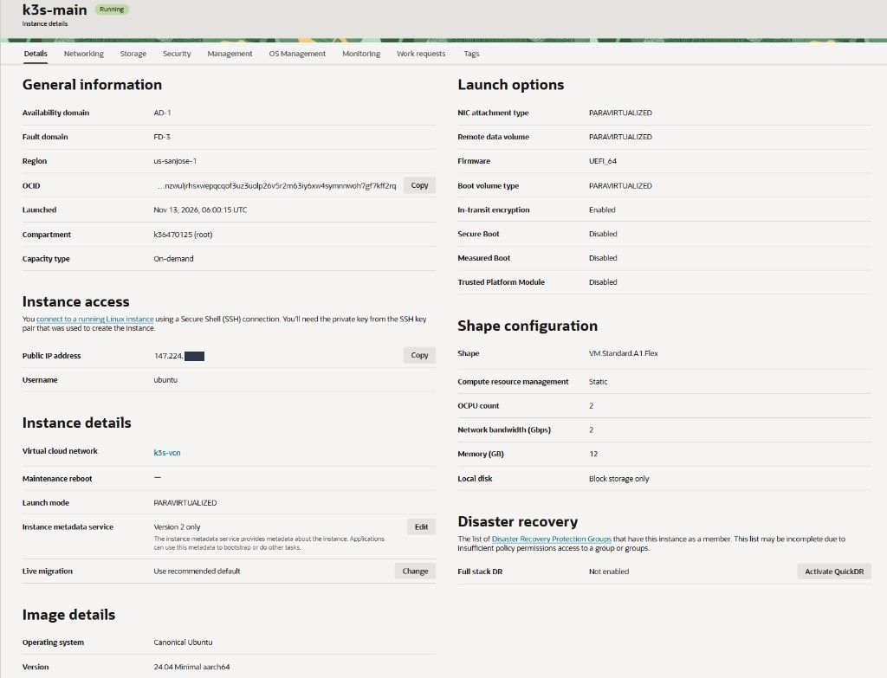

# 포트폴리오 상세 작업 기록집: Cloud Media Server & Zero-Trust Defense Network

> **프로젝트 요약**: Oracle Cloud Always Free ARM(Ampere A1) 인스턴스 위에 구축한 k3s(쿠버네티스) 기반 미디어 스트리밍 서버 및 이중 방화벽(Screening + Choke) 보안 검증 기록집입니다.  
> ※ 전체 요약 및 목차는 [README.md](./README.md)에서 확인할 수 있습니다.

---

## 0. 아키텍처 개요 (이중 방화벽 구조)



---

## 1. 인프라 프로비저닝 및 트러블슈팅 (OCI Always Free ARM)

### 1.1 문제 상황: 인기 리전 ARM 용량 부족 (`Out of host capacity`)
* **환경**: Oracle Cloud Infrastructure (OCI), US West (`us-sanjose-1`) 홈 리전
* **발생 오류**: `VM.Standard.A1.Flex` 인스턴스 생성 시 `500-InternalError, Out of host capacity` 에러가 반복 발생해 생성이 거부됨.

### 1.2 해결 과정: 자동 요청 매크로 제작 + 선확보 후 스케일업
1. **브라우저 DOM 자동화 스크립트 구현**: 오라클 콘솔의 생성 버튼(`button[aria-label="Create"]`)을 타겟팅하여 30초 간격으로 생성 요청을 재시도하는 [`oci_auto_creator_macro.js`](./02_infrastructure_oci/oci_auto_creator_macro.js) 작성.
2. **단계적 리소스 확보 전략**: 2 OCPU 연속 유휴 슬롯 대신 **1 OCPU / 6GB** 단위로 먼저 인스턴스를 확보한 뒤, PAYG 계정 업그레이드 및 리소스 조정을 통해 **2 OCPU / 12GB RAM**으로 안전하게 스케일업 완료.
3. **종료 안전장치**: 인스턴스 생성 성공 시 상세 페이지 URL(`/instances/ocid1.`) 전환을 감지해 타이머를 자동 종료.

#### 증빙 1: 자동 생성 매크로 실행 및 API 요청 로그


---

### 1.3 공인 IP 동적 바인딩 및 2 OCPU / 12GB 스케일업 검증

* **인스턴스명**: `k3s-main`
* **OS**: Canonical Ubuntu 24.04 Minimal `aarch64`
* **사양**: Ampere A1 (`2 OCPU / 12 GB RAM / 2 Gbps` 네트워크 대역폭)
* **스토리지**: 부트 볼륨 `100 GB` (총 200 GB 무료 한도 내)
* **네트워크**: VCN `k3s-vcn` / Subnet `k3s-subnet` / Private IP `10.0.0.5` / Public IP `147.224.xx.xx` (Ephemeral)

#### 증빙 2: Primary VNIC 공인 IP(Public IP) 동적 할당


#### 증빙 3: 2 OCPU / 12GB RAM 스케일업 및 `Running` 상태 검증


---

## 2. 서버 베이스라인 환경 구성 및 필수 도구 설치

* **OS 선정 이유**: 불필요한 백그라운드 데몬과 패키지를 제거해 공격 표면(Attack Surface)을 줄이고 가용 메모리를 극대화하기 위해 **Ubuntu 24.04 Minimal (`aarch64`)** 선택.
* **초기 설치 유틸리티 7종**:

```bash
sudo apt update && sudo apt install -y curl wget vim nano htop iotop net-tools
```

| 패키지 | 용도 및 선정 이유 |
| :--- | :--- |
| `curl`, `wget` | `k3s`, `rclone` 등 설치 스크립트 다운로드 및 API 응답 확인 |
| `vim`, `nano` | Kubernetes YAML 매니페스트 및 `systemd` 서비스 파일 편집 |
| `htop` | ARM64 CPU 코어별 부하 및 메모리 점유율 실시간 모니터링 |
| `iotop` | `rclone` VFS 캐시 쓰기/읽기 시 디스크 I/O 병목 분석 |
| `net-tools` | `netstat`, `ifconfig`, `route` 등 네트워크 포트 리스닝 상태 진단 |

---

## 3. 향후 기록 예정 항목
* **Screening Firewall**: OCI Security List 수신 규칙(22, 80, 443) 및 Ubuntu `iptables` 영구 저장 검증
* **k3s 클러스터**: 단일 노드 설치 및 `dmz` / `internal` 네임스페이스 분리 캡처
* **스토리지 가상화**: `rclone` pCloud VFS 캐시 마운트(`--vfs-cache-max-size 30G`) 및 Jellyfin Direct Play 검증
* **Choke Firewall & 침투 테스트**: `NetworkPolicy` 적용 후 DMZ Pod 내부에서 `nmap` 스캔을 통한 DB/모니터링 차단 증빙
