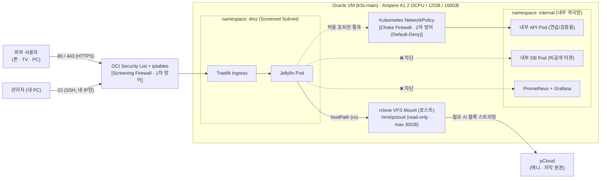
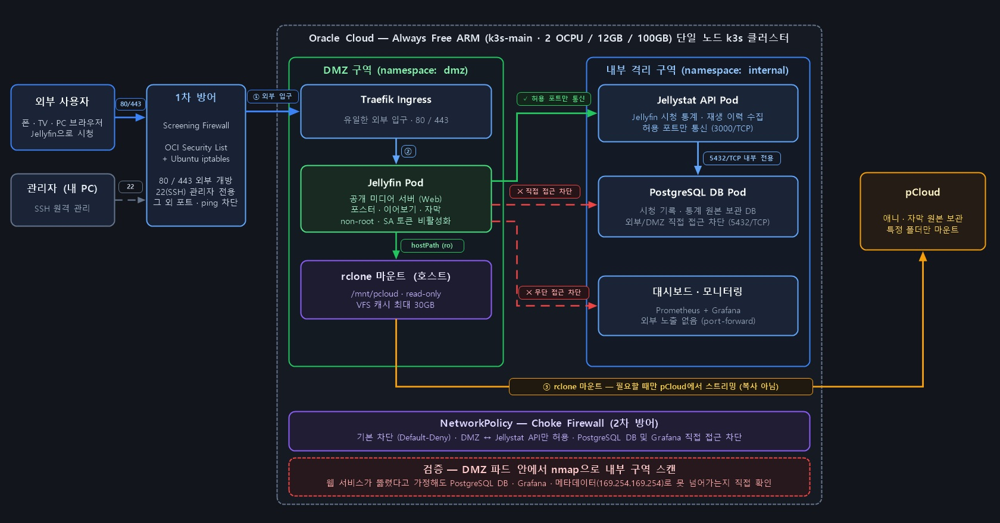
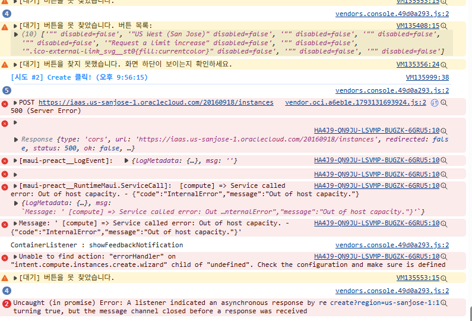
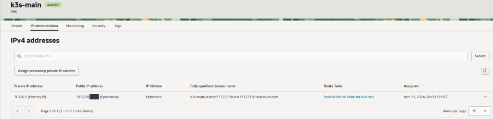
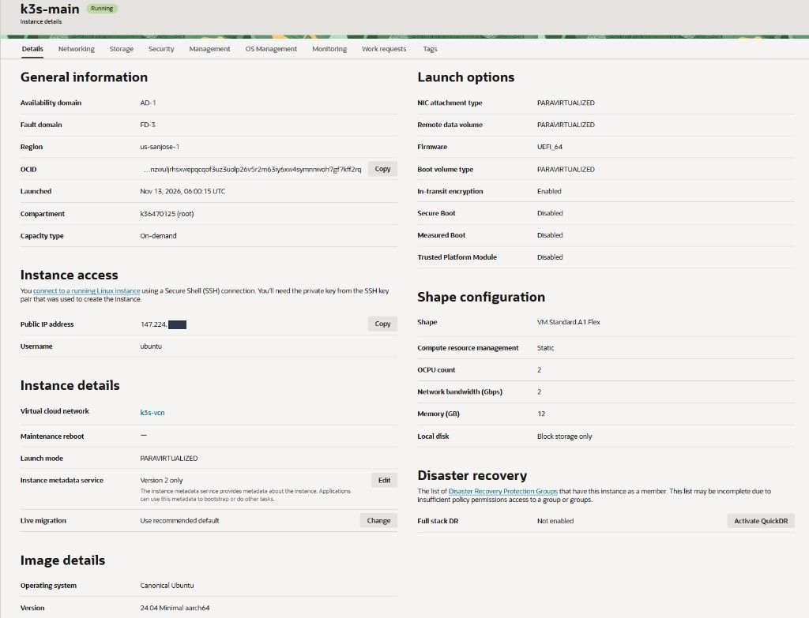

# Cloud Media Server & Zero-Trust Defense Network (k3s on OCI)

> **Oracle Cloud Always Free ARM(Ampere A1) 환경에 구축한 k3s 기반 미디어 스트리밍 서버 및 이중 방화벽(Screening + Choke) 보안 검증 프로젝트**


-3B82F6?style=flat-square)


---

## 목차 (Table of Contents)

- [1. 프로젝트 배경 및 목표](#1-프로젝트-배경-및-목표)
- [2. 전체 아키텍처 (Architecture)](#2-전체-아키텍처-architecture)
- [3. 클라우드 인프라 스펙 명세 (Infrastructure Spec)](#3-클라우드-인프라-스펙-명세-infrastructure-spec)
- [4. 단계별 구축 기록 및 트러블슈팅 (Implementation Log)](#4-단계별-구축-기록-및-트러블슈팅-implementation-log)
- [5. 디렉토리 구조 (Repository Structure)](#5-디렉토리-구조-repository-structure)
- [6. 진행 현황 및 로드맵 (Roadmap Checklist)](#6-진행-현황-및-로드맵-roadmap-checklist)

---

## 1. 프로젝트 배경 및 목표

| 구분 | 목표 및 구현 전략 |
| :--- | :--- |
| **미디어 스트리밍** | pCloud에 저장된 대용량 애니메이션/자막 원본을 복제 없이 `rclone` VFS 스트리밍으로 마운트하여, 어디서든 Jellyfin으로 원활하게 시청 |
| **이중 방화벽 실습** | 전통적인 네트워크 보안 모델인 **Screening Firewall + DMZ + Choke Firewall + Internal LAN** 구조를 Kubernetes 네임스페이스와 `NetworkPolicy`로 구현하고 `nmap` 침투 테스트로 검증 |
| **관측 가능성** | Prometheus & Grafana를 내부 구역(`internal`)에 배치해 노드 자원, 디스크 캐시, 서비스 상태를 모니터링 (외부 노출 차단) |
| **비용 0원 유지** | 전체 구성을 **Oracle Cloud Always Free** 한도(Ampere A1 2 OCPU / 12GB RAM / 200GB 스토리지) 내에서 운용 |

---

## 2. 전체 아키텍처 (Architecture)

### 2.1 구현 아키텍처 흐름도



### 2.2 이중 방화벽 개념 매핑

| 보안 계층 개념 | 이 프로젝트에서의 실제 구현 | 역할 |
| :--- | :--- | :--- |
| **Screening Firewall (1차 방어)** | **OCI Security List** + Ubuntu `iptables` | 외부에서 유입되는 트래픽 중 허용된 포트(22, 80, 443)만 통과 |
| **Screened Subnet (DMZ)** | Kubernetes `dmz` 네임스페이스 (`Traefik`, `Jellyfin`) | 인터넷에 노출되는 서비스만 격리 배치 |
| **Choke Firewall (2차 방어)** | Kubernetes **NetworkPolicy** (`Default-Deny`) | DMZ 서비스가 탈취되더라도 내부 구역으로의 횡적 이동(Lateral Movement) 차단 |
| **Internal LAN (내부망)** | Kubernetes `internal` 네임스페이스 (`API`, `DB`, `Grafana`) | 외부 직접 접근이 차단된 내부 서비스 및 모니터링 계층 |

### 2.3 초기 설계 구상도 (멀티 노드 참조 모델 → 단일 노드 최적화)

> 초기 멀티 노드(VM 3대) 구상안을 2026년 6월 개정된 OCI Always Free 한도(2 OCPU / 12GB)에 맞춰 단일 노드 네임스페이스 분리(B안)로 최적화했습니다.



---

## 3. 클라우드 인프라 스펙 명세 (Infrastructure Spec)

| 항목 | 구성 상세 | 비고 |
| :--- | :--- | :--- |
| **클라우드 환경** | Oracle Cloud Infrastructure (OCI) | US West (San Jose) 홈 리전 |
| **인스턴스명** | `k3s-main` | k3s 단일 노드 클러스터 |
| **컴퓨트 셰이프** | `VM.Standard.A1.Flex` (Ampere Neoverse N1 ARM64) | 서버용 고성능 ARM 프로세서 |
| **CPU / 메모리** | **2 OCPU (물리 2코어) / 12 GB RAM** | Always Free 상한 100% 활용 |
| **네트워크 대역폭** | **2 Gbps** | 고화질 스트리밍 병목 없음 |
| **부트 볼륨** | **100 GB** (총 200 GB 무료 풀 내) | rclone VFS 캐시 최대 30 GB 제한 예정 |
| **운영체제 (OS)** | Canonical Ubuntu 24.04 Minimal `aarch64` | 경량화 이미지 |
| **사설 IP (Private)** | `10.0.0.5` | VCN `k3s-vcn` / Subnet `k3s-subnet` |
| **공인 IP (Public)** | `147.224.xx.xx` (Ephemeral IPv4) | GitHub 공개 보안을 위해 일부 마스킹 처리 |

---

## 4. 단계별 구축 기록 및 트러블슈팅 (Implementation Log)

### 4.1 OCI ARM 용량 부족(`Out of host capacity`) 돌파

* **문제 상황**: US West (San Jose) 리전에서 무료 Ampere A1 인스턴스 생성 시 `500-InternalError: Out of host capacity` 오류가 지속 발생.
* **해결 전략**:
  1. 오라클 콘솔 UI의 `Create` 버튼(`button[aria-label="Create"]`)을 직접 탐색·클릭하는 브라우저 콘솔 자동화 스크립트([`oci_auto_creator_macro.js`](./02_infrastructure_oci/oci_auto_creator_macro.js))를 작성해 30초 주기로 생성 요청 자동화.
  2. 리소스 확보 확률을 높이기 위해 **1 OCPU / 6GB** 최소 단위로 먼저 인스턴스를 확보한 뒤, Pay As You Go 전환 및 리소스 확장을 통해 **2 OCPU / 12GB**로 스케일업 완료.
  3. 성공 후 인스턴스 상세 URL(`/instances/ocid1.`) 전환을 감지해 매크로가 자동 종료되도록 안전장치 구현.



---

### 4.2 공인 IP 동적 바인딩 및 2 OCPU / 12GB 스케일업 검증

인스턴스 초기 생성 당시 VCN/서브넷 설정 이슈로 공인 IP가 미할당 상태였으나, Primary VNIC의 **IP administration** 설정에서 Ephemeral Public IPv4(`147.224.xx.xx`)를 동적으로 바인딩했습니다. 이후 셰이프 스케일업을 거쳐 **2 OCPU / 12GB RAM / 2Gbps 대역폭**으로 정상 가동(`Running`)되는 것을 확인했습니다.

| ① VNIC 공인 IP 동적 할당 검증 | ② 2 OCPU / 12GB 스케일업 및 가동 검증 |
| :---: | :---: |
|  |  |

---

### 4.3 OS 베이스라인 구성 및 필수 유틸리티 7종 설치

불필요한 데몬과 패키지를 제거해 공격 표면(Attack Surface)과 메모리 점유율을 줄이기 위해 **Ubuntu 24.04 Minimal (`aarch64`)**을 채택하고, 운영 및 병목 분석에 필요한 핵심 도구 7종만 선별 설치했습니다.

```bash
sudo apt update && sudo apt install -y curl wget vim nano htop iotop net-tools
```

| 도구 | 설치 목적 및 활용 |
| :--- | :--- |
| `curl`, `wget` | k3s, rclone 설치 스크립트 및 REST API 테스트 |
| `vim`, `nano` | Kubernetes YAML 매니페스트 및 systemd 유닛 파일 편집 |
| `htop` | ARM 코어별 CPU 부하 및 메모리 사용량 실시간 확인 |
| `iotop` | rclone VFS 캐시 읽기/쓰기 시 디스크 I/O 병목 분석 |
| `net-tools` | `netstat`, `ifconfig`, 라우팅 및 리스닝 포트 상태 점검 |

---

## 5. 디렉토리 구조 (Repository Structure)

> ※ 보안 정책(`.gitignore`)에 따라 SSH 비밀키(`*.key`, `*.ppk`), 공개키(`*.pub`), 클라우드 인증 정보(`rclone.conf`)는 저장소에 업로드되지 않습니다.

```text
midea server/
├── .gitignore                        # SSH 키 및 rclone 인증 파일 업로드 차단
├── README.md                         # 프로젝트 마스터 포트폴리오 (현재 문서)
├── PORTFOLIO.md                      # 상세 작업 기록집
├── 01_architecture/                  # 아키텍처 다이어그램, 스펙 명세, 로드맵
│   ├── architecture_spec.md
│   ├── network_diagram.jpg
│   └── roadmap.md
├── 02_infrastructure_oci/            # OCI 프로비저닝 매크로 및 증빙 캡처
│   ├── oci_auto_creator_macro.js
│   └── screenshots/
│       ├── 01_macro_automation.png
│       ├── 02_public_ip_assigned.png
│       └── 03_instance_scaleup_verified.jpg
├── 03_kubernetes_k3s/                # k3s 매니페스트 및 클러스터 검증 캡처
│   ├── manifests/
│   └── screenshots/
├── 04_storage_rclone/                # pCloud 마운트 서비스 및 VFS 캐시 가이드
│   └── screenshots/
├── 05_security_firewall/             # NetworkPolicy YAML 및 nmap 침투 테스트 보고서
│   ├── network_policies/
│   └── screenshots/
└── 06_monitoring_grafana/            # Prometheus/Grafana 설정 및 대시보드 캡처
    └── screenshots/
```

---

## 6. 진행 현황 및 로드맵 (Roadmap Checklist)

- [x] **Phase 0**: Oracle Cloud 가입 및 리전/이미지 선택 (`Ubuntu 24.04 Minimal aarch64`)
- [x] **Phase 1**: Ampere A1 인스턴스 확보, 공인 IP 할당(`147.224.xx.xx`), 2 OCPU / 12GB 스케일업
- [x] **Phase 2**: SSH 접속, OS 패키지 업그레이드·보안 업데이트(`unattended-upgrades`), `iptables` 80/443 및 K3s CIDR 허용(`netfilter-persistent save`) 완료
- [ ] **Phase 3**: Screening Firewall (OCI Security List) 포트 규칙 구성 및 외부 `nmap` 점검
- [ ] **Phase 4**: k3s 단일 노드 클러스터 설치 및 `dmz` / `internal` 네임스페이스 분리
- [ ] **Phase 5**: `rclone` pCloud 연동 및 systemd 자동 마운트 (`--vfs-cache-max-size 30G`)
- [ ] **Phase 6**: Jellyfin 배포 (non-root, `hostPath` readOnly, SA 토큰 비활성화) 및 Direct Play 테스트
- [ ] **Phase 7**: 도메인 연결, cert-manager + Let's Encrypt HTTPS 적용, 로그인 보호(fail2ban/CrowdSec)
- [ ] **Phase 8**: `internal` 구역 더미 API/DB 및 `kube-prometheus-stack` (Prometheus + Grafana) 배포
- [ ] **Phase 9**: Choke Firewall (`NetworkPolicy` default-deny + 최소 허용 규칙) 적용
- [ ] **Phase 10**: DMZ Pod 내부에서 `nmap` 모의 침투 스캔 및 차단 결과 증빙 보고서 작성
